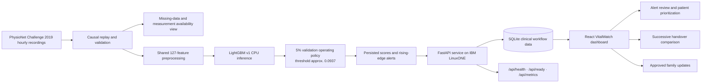

# Binus & SIM Collab_IBM Z Datathon 2026 Project — VitalWatch

VitalWatch is an AI-assisted clinical review prototype for ICU and emergency-care workflows. It analyzes replayed hourly vital-sign and laboratory measurements, identifies patients whose LightGBM research score crosses a review threshold, and helps clinicians prioritize assessment while retaining human control over acknowledgement, follow-up, handover, and family communication.

VitalWatch does **not** diagnose sepsis, produce calibrated patient probabilities, recommend treatment, or replace a clinician. Its score is an uncalibrated research output that requires clinical review.

## Problem

Subtle changes in a patient's vital signs can be difficult to recognize when care teams monitor many patients simultaneously and measurements are incomplete or irregular. A useful review tool must do more than show a model score: it should make missing data visible, preserve the patient timeline, explain why an alert exists, and help the care team carry new information into the next handover.

## Community value and Datathon theme

VitalWatch is an **AI for Good** healthcare project. It is designed for:

- ICU and emergency clinicians who need to prioritize patient review;
- nurses who verify concerning readings and document follow-up;
- hospital IT teams who need visibility into service health and inference latency;
- healthcare researchers who need to inspect data availability, held-out performance, false alerts, and limitations;
- patients and families who should receive only approved, plain-language updates.

The intended benefit is earlier and more organized review of concerning trends, not autonomous clinical decision-making. VitalWatch keeps alerts, evidence, missing measurements, handovers, and clinician actions distinct so that users can inspect what the system knows and what it does not know.

## Solution overview

The application combines causal replay, data-quality visibility, LightGBM inference, threshold-crossing alerts, clinician workflow, and operational monitoring.



The model is only one part of the system. The workflow around it makes the result reviewable: a new threshold crossing creates an alert, unresolved alerts influence patient ordering, missing measurements receive a reliability summary, and successive handover revisions show newly added information.

## Key features

- Ward overview with patient search, model-band filters, current readings, and trend summaries.
- Causal shared replay of recorded hourly patient data.
- LightGBM v1 CPU inference with saved per-hour scores and threshold-crossing alerts.
- Alert centre with acknowledgement, ownership, follow-up scheduling, and resolution history.
- In-app threshold notification popup for newly detected alerts.
- Patient ranking that prioritizes open unresolved alerts and then acknowledged unresolved alerts.
- Interactive vital and laboratory measurement-availability heatmap.
- Compact reliability summary showing coverage, recorded cells, missing cells, and latest recorded hour.
- Dedicated Performance view with validation, held-out test, and Dataset B check results.
- Successive handover comparison that highlights newly added lines between revisions.
- Restricted family view with clinician-approved updates only.
- Accessibility controls including text-size selection, keyboard navigation, visible focus states, and reduced-motion support.
- `/api/health`, `/api/ready`, and `/api/metrics` operational endpoints.
- Docker/Podman deployment files for a reproducible LinuxONE deployment.

## Model evidence

The checked-in evaluation artifact reports the following research results:

| Split | AUROC | AUPRC | Detected by onset at 5% policy | Non-sepsis patients alerted |
| --- | ---: | ---: | ---: | ---: |
| Validation | 0.818 | 0.133 | 45.5% | 5.0% |
| Held-out test | 0.822 | 0.135 | 46.1% | 4.9% |
| Dataset B check | 0.799 | 0.076 | 34.4% | 2.3% |

The held-out test median lead time at the selected policy is approximately 34 hours. These are offline research metrics from `results/eval_v1.json`; they are not clinical validation, calibration, or evidence that the model is safe for patient care.

The application uses the stricter validation policy named `5pct_false_alert_patients`, with a stored threshold of approximately `0.0937`. The policy name is an evaluation operating point, not a guaranteed alert rate for a new hospital or population.

## IBM LinuxONE deployment

VitalWatch is designed to run as a containerized FastAPI service with the React frontend served by the backend. The application, SQLite workflow store, LightGBM model, replay worker, and operational endpoints can run inside the LinuxONE environment.

The repository includes:

- `Dockerfile` — multi-stage frontend build and Python runtime image;
- `compose.yml` — Docker Compose / Podman Compose service definition;
- `.dockerignore` — excludes credentials, databases, build output, and local environments;
- `/api/health` — basic service response;
- `/api/ready` — database readiness check;
- `/api/metrics` — process uptime, request count, latest request latency, inference latency, database state, and prediction-provider status.

### LinuxONE evidence placeholder

Add screenshots or exported terminal captures to the repository before submission. Suggested locations:

```text
docs/evidence/linuxone-container.png
docs/evidence/linuxone-health.png
docs/evidence/linuxone-ready.png
docs/evidence/linuxone-metrics.png
docs/evidence/linuxone-app.png
docs/evidence/linuxone-model.png
```

After adding the evidence files, replace the placeholders below with the actual images:

```md


```

### Commands to capture LinuxONE evidence

Run these commands on the LinuxONE host. Replace the image/host placeholder values with the actual deployment values. Do not include passwords, API keys, cookies, private IPs that should not be public, or database contents in screenshots.

```bash
# 1. Confirm the container is running.
podman ps --format 'table {{.Names}}\t{{.Image}}\t{{.Status}}\t{{.Ports}}'
# Use `docker ps` instead if Docker is the runtime.

# 2. Set the deployed base URL.
export VITALWATCH_URL="http://<LINUXONE_HOST>:8000"

# 3. Capture basic health and database readiness.
curl -i "$VITALWATCH_URL/api/health" | tee docs/evidence/api-health.txt
curl -i "$VITALWATCH_URL/api/ready" | tee docs/evidence/api-ready.txt

# 4. Capture measured runtime information.
curl -sS "$VITALWATCH_URL/api/metrics" | tee docs/evidence/api-metrics.json

# 5. Capture the container logs without secrets.
podman logs --tail 120 vitalwatch | tee docs/evidence/linuxone-container.log
# Use `docker logs --tail 120 vitalwatch` if Docker is the runtime.

# 6. Confirm the deployed frontend and API are reachable.
curl -I "$VITALWATCH_URL/"
curl -I "$VITALWATCH_URL/api/docs"
```

For the final video, show the terminal, the running container, the model-loaded state, the dashboard URL, and one alert threshold crossing. The `/api/metrics` output should be captured after the application has processed representative requests so that request and inference latency fields are populated.

## Technology stack

- **Frontend:** React, TypeScript, Vite, Recharts, React Feather.
- **Backend:** Python, FastAPI, SQLAlchemy, SQLite, Uvicorn.
- **Predictive AI:** LightGBM v1 with shared 127-feature preprocessing and a stored logistic-regression comparison baseline.
- **Deployment:** Docker or Podman, Compose-compatible service definition, IBM LinuxONE target environment.
- **Data quality:** replay cutoff enforcement, missingness preservation, measurement availability heatmap, and reliability summary.

This submission intentionally presents LightGBM as the implemented AI model. A generative-AI provider interface exists in the codebase as optional infrastructure, but it is not required for monitoring and is not presented here as a live part of the core submission workflow.

## Dataset and references

- [PhysioNet Challenge 2019 training dataset](https://physionet.org/content/challenge-2019/1.0.0/training/)
- [PhysioNet / Computing in Cardiology Challenge 2019](https://physionet.org/content/challenge-2019/1.0.0/)
- [Challenge paper](https://pmc.ncbi.nlm.nih.gov/articles/PMC6964870/)
- [VitalWatch GitHub repository](https://github.com/ponskigila-hub/vital-watch)
- [IBM Hack2Skill Datathon 2026 submission page](https://hack2skill.com/event/datathon-2026)
- [Datathon submission guidance video](https://youtu.be/3_L3T__zEco?si=Q-ckiVTP6ByvgZEv)

Open-source libraries are used under their respective licenses. Review the dependency manifests and license notices before submission.

## Local development

### Prerequisites

- Python 3.12 or newer;
- Node.js 20 or newer;
- Git.

### Backend

```bash
git clone https://github.com/ponskigila-hub/vital-watch.git
cd vital-watch
python3 -m venv .venv
.venv/bin/python -m pip install -r api/requirements.txt
cp api/.env.example api/.env
.venv/bin/python -m api.app.cli init
.venv/bin/python -m uvicorn api.app.main:app --host 127.0.0.1 --port 8000
```

### Frontend development server

In a second terminal:

```bash
cd vital-watch/frontend
npm ci
npm run dev
```

Open `http://127.0.0.1:5173/`. Vite forwards API requests to the backend during development.

### One-server production-style run

```bash
npm ci --prefix frontend
npm run build --prefix frontend
.venv/bin/python -m uvicorn api.app.main:app --host 127.0.0.1 --port 8000
```

Open `http://127.0.0.1:8000/`.

### Container run

```bash
cp api/.env.example api/.env
podman compose up --build
# or: docker compose up --build
```

Open `http://127.0.0.1:8000/` and verify `/api/health` and `/api/ready`.

## Demo accounts and safety

Initialization creates local demo credentials in `api/.demo-credentials.json`. This file is private, generated per installation, excluded from Git, and must never be uploaded. The system uses fictional display identities and replayed records for demonstration.

VitalWatch is not a medical device and has not undergone independent clinical validation, calibration assessment, prospective evaluation, or live hospital-device integration. Current operation is replay-based. The model score is uncalibrated and must not be interpreted as a patient probability or diagnosis. Missing data and a low score do not establish absence of sepsis.

## Verification

The current local verification results are:

- 69 backend tests passed;
- 9 frontend tests passed;
- TypeScript and production frontend build passed;
- repository whitespace check passed.

The final submission should add the LinuxONE host evidence and repeat the health, readiness, and metrics checks on the deployed instance.

## Team contributions

Replace this table before submission:

| Team member | Contribution |
| --- | --- |
| `<Name>` | Model training, feature engineering, and evaluation |
| `<Name>` | Backend, deployment, and LinuxONE integration |
| `<Name>` | Frontend, UX, accessibility, and demo workflow |
| `<Name>` | Research, documentation, testing, and submission |

## License

Add the project license selected by the team here. Preserve the PhysioNet dataset attribution and the licenses of all open-source dependencies.
