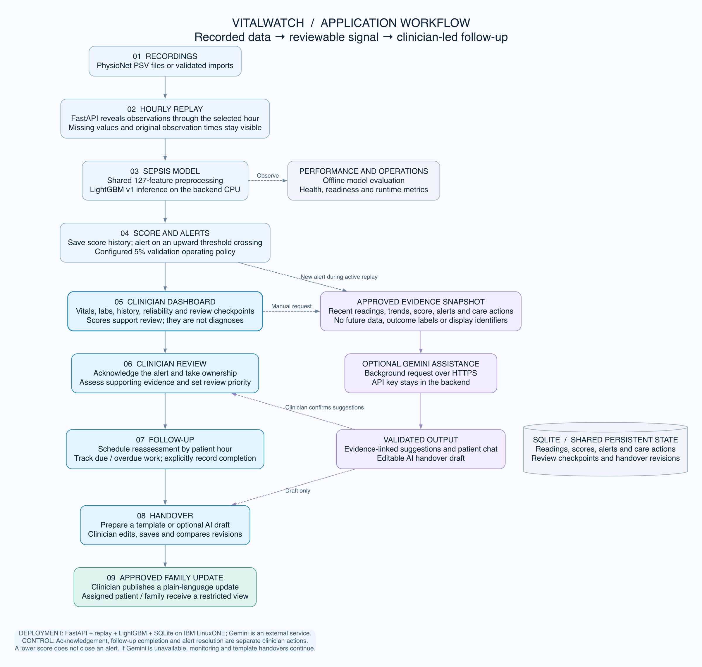
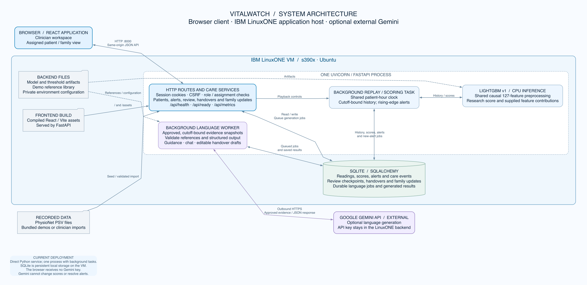
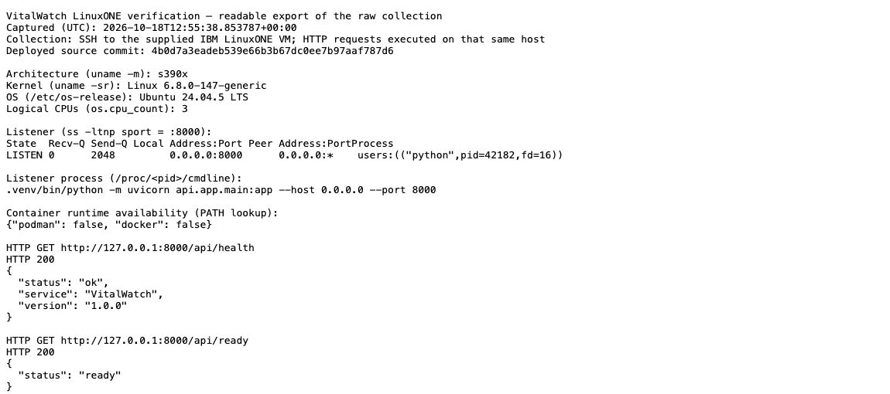
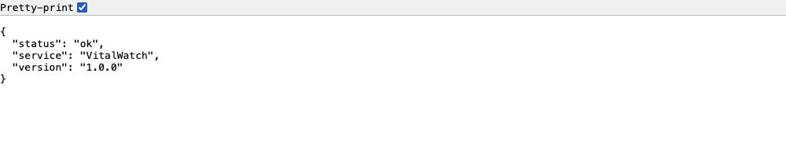
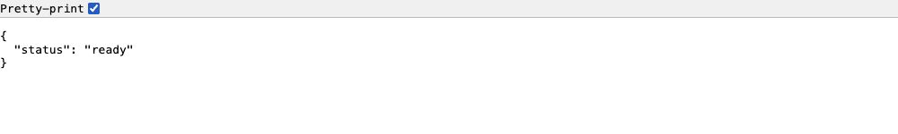
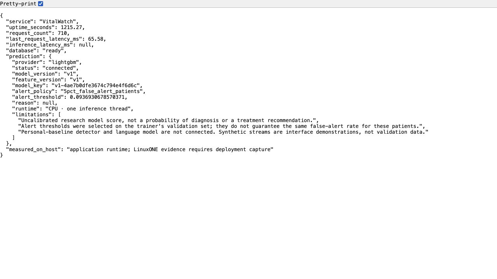
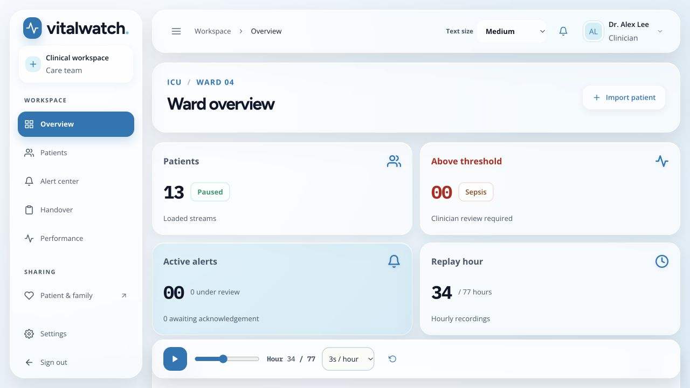
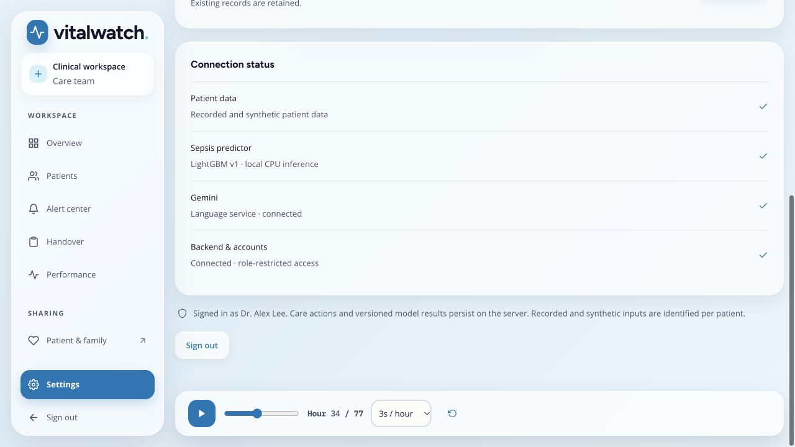

# Binus & SIM Collab_IBM Z Datathon 2026 Project — VitalWatch


VitalWatch is an AI-assisted clinical review prototype for ICU and emergency-care workflows. It analyzes replayed hourly vital-sign and laboratory measurements, identifies patients whose LightGBM research score crosses a review threshold, and helps clinicians prioritize assessment while retaining human control over acknowledgement, follow-up, handover, and family communication.

VitalWatch does **not** diagnose sepsis, produce calibrated patient probabilities, recommend treatment, or replace a clinician. Its score is an uncalibrated research output that requires clinical review.

## Problem

Subtle changes in a patient's vital signs can be difficult to recognize when care teams monitor many patients simultaneously and measurements are incomplete or irregular. A useful review tool must do more than show a model score: it should make missing data visible, preserve the patient timeline, explain why an alert exists, and help the care team carry new information into the next handover.

## Community value and Datathon theme

VitalWatch is an **AI for Good** healthcare project. It is designed for:

- ICU and emergency clinicians who need to prioritize patient review;

- nurses who verify concerning readings and document follow-up;

- hospital IT teams who need visibility into service health and inference latency;

- healthcare researchers who need to inspect data availability, held-out performance, false alerts, and limitations;

- patients and families who should receive only approved, plain-language updates.

The intended benefit is earlier and more organized review of concerning trends, not autonomous clinical decision-making. VitalWatch keeps alerts, evidence, missing measurements, handovers, and clinician actions distinct so that users can inspect what the system knows and what it does not know.

## Solution overview

Recorded patient data moves through hourly replay and LightGBM scoring into clinician review, follow-up, handover, and approved family updates. Optional Gemini assistance explains supplied evidence and drafts text; clinicians remain responsible for care decisions and completing actions.



[Workflow details](docs/workflow.md) · [SVG](docs/workflow.svg) · [Editable Mermaid](docs/workflow.mmd)

### System architecture

The React client connects to FastAPI on IBM LinuxONE. One backend process runs the replay/scoring task, LightGBM CPU inference, and the language worker, with persistent SQLite storage. Optional Gemini requests leave the backend over HTTPS; API keys remain on the server.



[Architecture details](docs/architecture.md) · [SVG](docs/architecture.svg) · [Editable Mermaid](docs/architecture.mmd)

## Key features

- Ward overview with patient search, model-band filters, current readings, and trend summaries.

- Causal shared replay of recorded hourly patient data.

- LightGBM v1 CPU inference with saved per-hour scores and threshold-crossing alerts.

- Alert centre with acknowledgement, ownership, follow-up scheduling, and resolution history.

- In-app threshold notification popup for newly detected alerts.

- Patient ranking that prioritizes open unresolved alerts and then acknowledged unresolved alerts.

- Interactive vital and laboratory measurement-availability heatmap.

- Compact reliability summary showing coverage, recorded cells, missing cells, and latest recorded hour.

- Dedicated Performance view with validation, held-out test, and Dataset B check results.

- Successive handover comparison that highlights newly added lines between revisions.

- Restricted family view with clinician-approved updates only.

- Accessibility controls including text-size selection, keyboard navigation, visible focus states, and reduced-motion support.

- `/api/health`, `/api/ready`, and `/api/metrics` operational endpoints.

- Docker/Podman deployment files for a reproducible LinuxONE deployment.

## Model evidence

The checked-in evaluation artifact reports the following research results:

| Split | AUROC | AUPRC | Detected by onset at 5% policy | Non-sepsis patients alerted |
| --- | --- | --- | --- | --- |
| Validation | 0.818 | 0.133 | 45.5% | 5.0% |
| Held-out test | 0.822 | 0.135 | 46.1% | 4.9% |
| Dataset B check | 0.799 | 0.076 | 34.4% | 2.3% |

The held-out test median lead time at the selected policy is approximately 34 hours. These are offline research metrics from `results/eval_v1.json`; they are not clinical validation, calibration, or evidence that the model is safe for patient care.

The application uses the stricter validation policy named `5pct_false_alert_patients`, with a stored threshold of approximately `0.0937`. The policy name is an evaluation operating point, not a guaranteed alert rate for a new hospital or population.

## IBM LinuxONE deployment

VitalWatch is running on the supplied IBM LinuxONE VM as a **Uvicorn/FastAPI Python process**, serving the React frontend, SQLite workflow store, LightGBM model, replay worker, and operational endpoints. SSH inspection confirmed **s390x** architecture. Container configuration is included in the repository, but the captured deployment is **not containerized**; neither Docker nor Podman was installed in the inspected host's PATH.

The repository includes:

- `Dockerfile.vm` — supplied container build recipe, separate from the captured Python-process deployment;

- `compose.yml` — Docker Compose / Podman Compose service definition;

- `.dockerignore` — excludes credentials, databases, build output, and local environments;

- `/api/health` — basic service response;

- `/api/ready` — database readiness check;

- `/api/metrics` — process uptime, request count, latest request latency, inference latency, database state, and prediction-provider status.

### Verified LinuxONE deployment evidence

Captured **18 October 2026, 12:55 UTC** directly over SSH to the supplied LinuxONE VM. The HTTP checks below ran on that same host. Its deployed checkout at capture was `4b0d7a3`; these are recorded observations, not continuously updated status badges.

| Check | Observed result |
| --- | --- |
| Architecture / OS | `s390x` / Ubuntu 24.04.5 LTS |
| Kernel / logical CPUs | Linux 6.8.0-147-generic / 3 |
| Running service | `.venv/bin/python -m uvicorn api.app.main:app --host 0.0.0.0 --port 8000` |
| Port listener | Python process listening on port 8000 |
| `/api/health` | HTTP 200; VitalWatch `status: ok` |
| `/api/ready` | HTTP 200; `status: ready` |
| `/api/metrics` | HTTP 200; database ready; LightGBM v1 connected |
| Process uptime / request count | 1,108.6 seconds / 602 requests at collection |
| Model runtime / policy | CPU, one inference thread / `5pct_false_alert_patients` |

Inspect the [raw SSH/HTTP verification](docs/evidence/linuxone-verification.json), [readable host report](docs/evidence/linuxone-host.txt), [health response](docs/evidence/api-health.json), [readiness response](docs/evidence/api-ready.json), and [metrics response](docs/evidence/api-metrics.json). The reports contain no credentials, cookies, private configuration, or patient records.

**1. LinuxONE host and running service**

The original `linuxone-container.png` filename is retained for the evidence layout. This capture shows the SSH-collected host/service report for the direct Python deployment; it is not evidence of a running container.



**2. Health response**



**3. Database readiness**



**4. Runtime metrics**



**5. Hosted application**

Captured after signing into [the LinuxONE demo](http://148.100.108.67:8000/), using replayed records and fictional display identities.



**6. Model connection status**



The browser screenshots were collected separately from the raw SSH report, so live counters differ. `inference_latency_ms` was `null` in the metrics capture; no inference-latency benchmark, accelerator use, or container execution is claimed. These captures establish the observed service state, not clinical effectiveness. See [evidence provenance](docs/evidence/README.md).

### Repeat the host checks

Run on the LinuxONE VM; these commands do not expose application secrets:

```bash
cd ~/vital-watch
uname -m
uname -sr
ss -ltnp 'sport = :8000'
git rev-parse HEAD
curl -fsS http://127.0.0.1:8000/api/health
curl -fsS http://127.0.0.1:8000/api/ready
curl -fsS http://127.0.0.1:8000/api/metrics
```

For the final video, show the LinuxONE host checks, running Python service, connected model, hosted dashboard, and a recorded alert threshold crossing. Only show a container if a container deployment is actually running and has been verified.

## Final submission guide

Use this section to finish the public README and submission package. The current live demo can be linked with a readable label without changing the IP address:

```
[Open VitalWatch live demo on IBM LinuxONE](http://148.100.108.67:8000/ )
```

Run these commands on the LinuxONE VM after the application has processed representative requests:

```bash
cd ~/vital-watch
mkdir -p docs/evidence
export VITALWATCH_URL="http://148.100.108.67:8000"
curl -sS "$VITALWATCH_URL/api/health" | tee docs/evidence/api-health.json
curl -sS "$VITALWATCH_URL/api/ready" | tee docs/evidence/api-ready.json
curl -sS "$VITALWATCH_URL/api/metrics" | tee docs/evidence/api-metrics.json
tmux ls | tee docs/evidence/linuxone-tmux.txt
tail -80 ~/vitalwatch.log | tee docs/evidence/linuxone-log.txt
```

Host verification, health/readiness, metrics, and dashboard evidence are already checked in under `docs/evidence/`. Refresh the captures if the deployment changes. Container evidence remains separate work because the captured app runs directly in Python. Do not commit passwords, API keys, cookies, `.demo-credentials.json`, database files, or unredacted private configuration.

Before submitting, replace `[TEAM NAME]`, complete the team-contribution table, add the final video URL, and replace the project license placeholder. A suggested link block is:

```
## Submission links

- GitHub: https://github.com/ponskigila-hub/vital-watch
- Live demo: http://148.100.108.67:8000/
- Demo video: <PASTE-YOUR-MAX-3-MINUTE-VIDEO-LINK>
- Architecture flowchart: [docs/architecture.mmd](docs/architecture.mmd )
```

The three-minute video should show, in order: the problem and PhysioNet data; the flowchart; LinuxONE terminal and running service; dashboard; one threshold-crossing notification; patient prioritization; reliability summary; handover comparison; and the Performance page. Close by stating that LightGBM provides an uncalibrated research score for clinician review and that VitalWatch does not diagnose sepsis or replace clinical judgment.

Final pre-submission checks:

```bash
git status --short
git diff --check
grep -n '\[TEAM NAME\]\|<PASTE-YOUR' README.md
```

The public demo credentials in this README are for a fresh demo installation. A LinuxONE database reset with different values will use the credentials currently configured in that host's private `api/.env`.

## Technology stack

- **Frontend:** React, TypeScript, Vite, Recharts, React Feather.

- **Backend:** Python, FastAPI, SQLAlchemy, SQLite, Uvicorn.

- **Predictive AI:** LightGBM v1 with shared 127-feature preprocessing and a stored logistic-regression comparison baseline.

- **Deployment:** Docker or Podman, Compose-compatible service definition, IBM LinuxONE target environment.

- **Data quality:** replay cutoff enforcement, missingness preservation, measurement availability heatmap, and reliability summary.

This submission presents LightGBM as the implemented predictive AI model. An optional Gemini language provider is also available for evidence-grounded summaries, clinician chat, and editable handover drafts. Gemini is not required for monitoring, scoring, alert generation, or the core submission workflow. Only describe Gemini as live in the final pitch after it has been tested successfully on the LinuxONE deployment with synthetic demo data.

## Optional language service

The language service is disabled by default in the repository template. To enable it for a controlled demo, configure the following values on the LinuxONE host in the private `api/.env` file:

```
LANGUAGE_PROVIDER=gemini
GEMINI_API_KEY=<private-key-not-committed-to-git>
GEMINI_MODEL=gemini-3.5-flash-lite
GEMINI_FALLBACK_MODELS=gemini-3.1-flash-lite
```

Restart the backend after changing the provider because the configuration is loaded at application startup:

```bash
cd ~/vital-watch
tmux kill-session -t vitalwatch 2>/dev/null || true
pkill -f '[u]vicorn api.app.main' 2>/dev/null || true
sleep 2
tmux new -d -s vitalwatch 'cd ~/vital-watch && .venv/bin/python -m uvicorn api.app.main:app --host 0.0.0.0 --port 8000 2>&1 | tee ~/vitalwatch.log'
sleep 5
```

Verify the setting without printing the API key:

```bash
awk -F= '
/^LANGUAGE_PROVIDER=/ { print $0 }
/^GEMINI_API_KEY=/ { print $1 "=" (length($2) > 0 ? "<configured>" : "<empty>") }
/^GEMINI_MODEL=/ { print $0 }
' api/.env
```

Use only synthetic demo records for a language-service smoke test. A suitable test prompt is:

```
Summarize the recorded vital-sign changes for this patient and identify which measurements should be reviewed by the clinician.
```

The language response is an optional generated summary. Clinicians must review the original measurements and supporting evidence directly. Do not send real patient data, API keys, passwords, cookies, or private configuration to the provider. If the provider is unavailable, the core LightGBM monitoring workflow continues and the interface should state that no AI language answer was generated.

If Gemini is successfully verified on LinuxONE, add a redacted screenshot to `docs/evidence/gemini-status.png` and document the verification date here:

```
Gemini LinuxONE smoke test: <DATE, MODEL, SYNTHETIC-DATA-ONLY RESULT>
```

If the smoke test is not successful, keep the language service documented as optional and do not include it in the core video claim.

## Dataset and references

- [PhysioNet Challenge 2019 training dataset](https://physionet.org/content/challenge-2019/1.0.0/training/)

- [PhysioNet / Computing in Cardiology Challenge 2019](https://physionet.org/content/challenge-2019/1.0.0/)

- [Challenge paper](https://pmc.ncbi.nlm.nih.gov/articles/PMC6964870/)

- [VitalWatch GitHub repository](https://github.com/ponskigila-hub/vital-watch)

- [IBM Hack2Skill Datathon 2026 submission page](https://hack2skill.com/event/datathon-2026)

- [Datathon submission guidance video](https://youtu.be/3_L3T__zEco?si=Q-ckiVTP6ByvgZEv)

Open-source libraries are used under their respective licenses. Review the dependency manifests and license notices before submission.

## Local development

### Prerequisites

- Python 3.12 or newer;

- Node.js 20 or newer;

- Git.

### Backend

```bash
git clone https://github.com/ponskigila-hub/vital-watch.git
cd vital-watch
python3 -m venv .venv
.venv/bin/python -m pip install -r api/requirements.txt
cp api/.env.example api/.env
.venv/bin/python -m api.app.cli init
.venv/bin/python -m uvicorn api.app.main:app --host 127.0.0.1 --port 8000
```

### Frontend development server

In a second terminal:

```bash
cd vital-watch/frontend
npm ci
npm run dev
```

Open `http://127.0.0.1:5173/`. Vite forwards API requests to the backend during development.

### One-server production-style run

```bash
npm ci --prefix frontend
npm run build --prefix frontend
.venv/bin/python -m uvicorn api.app.main:app --host 127.0.0.1 --port 8000
```

Open `http://127.0.0.1:8000/`.

### Container run

```bash
cp api/.env.example api/.env
podman compose up --build
# or: docker compose up --build
```

Open `http://127.0.0.1:8000/` and verify `/api/health` and `/api/ready`.

## Public demo credentials

These credentials are intentionally published for the hackathon demo video only. They are not secrets and must never be used with real patient data, production infrastructure, or a reused database. Change or remove them after submission.

| Role | Email | Demo password |
| --- | --- | --- |
| Clinician | `clinician@vitalwatch.local` | `VWClinician-qpwDtOUyJ3M5L57gqE!` |
| Family | `family@vitalwatch.local` | `VWFamily-nnwoLOKkCXjmloY2qA!` |

For a safer deployment, remove these values from the public README and use locally generated credentials from `api/.demo-credentials.json` instead.

## Demo accounts and safety

Initialization creates local demo credentials in `api/.demo-credentials.json`. This file is private, generated per installation, excluded from Git, and must never be uploaded. The system uses fictional display identities and replayed records for demonstration.

VitalWatch is not a medical device and has not undergone independent clinical validation, calibration assessment, prospective evaluation, or live hospital-device integration. Current operation is replay-based. The model score is uncalibrated and must not be interpreted as a patient probability or diagnosis. Missing data and a low score do not establish absence of sepsis.

## Verification

The current local verification results are:

- 69 backend tests passed;

- 9 frontend tests passed;

- TypeScript and production frontend build passed;

- repository whitespace check passed.

LinuxONE host evidence, health/readiness responses, runtime metrics, and actual hosted-app screenshots are linked in the verified deployment section above. Repeat those checks if the deployment changes.

## Team contributions

Replace this table before submission:

| Team member | Contribution |
| --- | --- |
| `Nicholas Driyadis Tjoe` | Model training, feature engineering, and evaluation |
| `Rivaldo Caga Prawira Tjong` | Backend, deployment, submission, and LinuxONE integration |
| `Gerald Amadeo Passover Sutanto` | Frontend, UX, accessibility, and demo workflow |
| `Christian Caesar` | Research, documentation, and testing |

## License

Add the project license selected by the team here. Preserve the PhysioNet dataset attribution and the licenses of all open-source dependencies.
